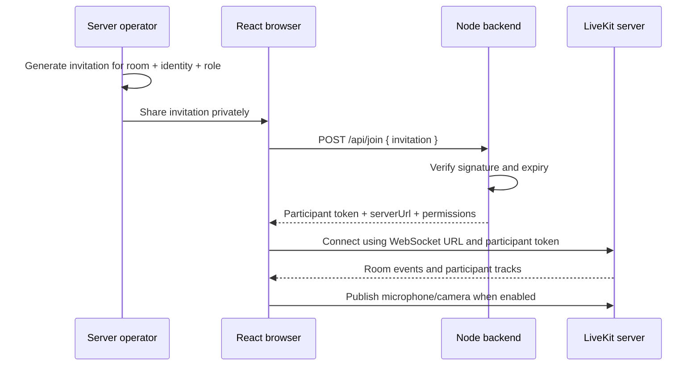

# LiveKit setup and React integration guide

For the exact commands to start your backend and frontend locally, follow **[the step-by-step startup document](../START_HERE.md)**. No native LiveKit installation is needed for that workflow.

**Recommended: [run the complete stack with Docker](DOCKER.md).** Docker runs LiveKit, Node, and the built React client without host installations. Sections 2–3 below describe the optional native development workflow; the architecture, invitation, React, and API sections apply to both.

## 1. What runs where

This project has three parts:

| Part | Default local address | Responsibility |
| --- | --- | --- |
| Node.js backend | `http://127.0.0.1:3000` | Verify invitations, sign join tokens, manage rooms |
| LiveKit media server | `ws://127.0.0.1:7880` | Connect participants and forward audio/video/data |
| React example | `http://127.0.0.1:5173` | Join form, camera/microphone, conference UI |



Audio/video does not pass through the Node backend. LiveKitRoom manages the browser connection and provides context to its child components; VideoConference provides the meeting UI. See the official [LiveKitRoom reference](https://docs.livekit.io/reference/components/react/component/livekitroom/) and [VideoConference reference](https://docs.livekit.io/reference/components/react/component/videoconference/).

## 2. First-time configuration

Requirements: Node.js 24+, npm, and a LiveKit server binary. Install the binary from the [official releases](https://github.com/livekit/livekit/releases) or follow [LiveKit's local installation guide](https://docs.livekit.io/transport/self-hosting/local/). For the Docker workflow, none of these binaries need to be installed on your host; use the Docker guide instead.

From the repository root on a fresh checkout:

```bash
npm ci
npm run setup
npm --prefix examples/react-client ci
```

**In the workspace prepared by this change, setup has already been run.** Continue with section 3. On other machines, run setup once. It creates:

- `.env`: backend settings and random credentials.
- `config/livekit.yaml`: matching LiveKit API key/secret and local network settings.

Both files are ignored by git and created with owner-only read/write permissions. The generator refuses to overwrite either file. Keep them together as one environment. If you already have a manually configured `.env`, add `INVITE_SIGNING_SECRET` with a fresh random value of at least 32 characters and ensure your media server uses the same LiveKit key/secret as the backend. Do not delete a working environment just to rerun setup.

Generated local LiveKit settings: signaling TCP 7880 on loopback, media TCP 7881, UDP mux 7882, external-IP discovery disabled, and random credentials. Start with the generated config; `--dev` uses a different credential pair and will not match it.

### Backend environment variables

| Variable | Meaning | Sent to React? |
| --- | --- | --- |
| `HOST` / `PORT` | Node bind address; defaults to `127.0.0.1:3000` | No |
| `NODE_ENV` | `development` locally, `production` on Ubuntu | No |
| `BACKEND_API_KEY` | Bearer key protecting administrative `/api/token`, `/api/rooms`, `/api/ready` | Never |
| `INVITE_CREATOR_KEY` | Host-only invitation creation key; optional, creation disabled when unset | Entered manually by the host only |
| `INVITE_SIGNING_SECRET` | Independent HMAC key for invitation creation/verification | Never |
| `LIVEKIT_API_KEY` | Identifies the LiveKit API credential pair | Not required by client |
| `LIVEKIT_API_SECRET` | Signs LiveKit participant and service tokens | Never |
| `LIVEKIT_URL` | HTTP(S) endpoint reachable by Node for LiveKit server APIs | No |
| `LIVEKIT_WS_URL` | WS(S) signaling endpoint reachable by participants | Yes, as `serverUrl` |

Environment variables already set in your shell override `.env`. Production configuration rejects `devkey`, short LiveKit secrets, and a non-WSS participant URL. The backend key and invitation secret each require at least 32 characters.

The two LiveKit URLs may differ: an internal `http://livekit:7880` for Node and a public `wss://livekit.example.com` for browsers. An internal container hostname or a server's `localhost` address will not work as a remote participant URL.

## 3. Start all three processes

Terminal 1, repository root:

```bash
livekit-server --config config/livekit.yaml
```

Terminal 2, repository root:

```bash
npm run dev
```

Terminal 3, repository root:

```bash
npm --prefix examples/react-client run dev
```

Open **http://127.0.0.1:5173**. Keep these terminals running. Use `npm start` for Node without automatic restart; Ctrl+C stops each process.

The React development server forwards only `/api/join` to Node. Its optional `BACKEND_URL` setting is in `examples/react-client/.env.example`; no configuration is needed for the default port 3000. If you change that port, copy that example to `.env.local`, update `BACKEND_URL`, and restart Vite.

## 4. Generate invitations and make a call

**React host form:** expand **Create an invitation · Host** on the join page. Enter the separate `INVITE_CREATOR_KEY` from your environment, choose the participant settings, and click **Generate invitation**. The API is `POST /api/invitations` authenticated with that dedicated key; it does not grant room administration. This key is manually entered into browser memory, never bundled into frontend configuration. See [the invitation guide](INVITATIONS.md) for the complete flow. CLI generation below is still supported.

Use a fourth terminal in the repository root:

```bash
npm run --silent invite -- --room demo --identity alice --name Alice
npm run --silent invite -- --room demo --identity bob --name Bob
```

Each command prints one invitation code. Paste Alice's code into the first browser tab and Bob's into a second tab. Both must use the same room and different identities. Click **Join room**. Camera and microphone are off initially; select them before joining or turn them on through the meeting controls. To avoid audio feedback while testing two tabs on one device, use headphones and enable only one microphone.

An invitation fixes the room, identity, name, role, and expiry. The browser cannot change these fields. It contains readable signed data, not encrypted data. Treat it as a room-access credential and share it privately.

### Viewer invitations

```bash
npm run --silent invite -- --room demo --identity viewer-1 --name Viewer --role viewer --ttl 3600
```

| CLI option | Default / limits |
| --- | --- |
| `--room` | Required; nonblank, up to 128 characters |
| `--identity` | Required; nonblank, up to 128 characters; unique within a room |
| `--name` | Defaults to identity; up to 128 characters |
| `--role` | `publisher` or `viewer`; defaults to `publisher` |
| `--ttl` | Invitation lifetime in seconds; defaults to 900; accepts 1–86400 |

Publishers can publish media and data and subscribe to others. Viewers can subscribe but cannot publish media/data. Neither receives administrative room privileges. The server signs participant tokens using the [official AccessToken API](https://docs.livekit.io/reference/server-sdk-js/classes/AccessToken.html).

The CLI runs on a trusted server or workstation with the environment secrets. The React host form requests invitation generation from the backend; signing always happens on the server. No login or user database is required in this version. Whoever holds an invitation can act as that participant, so do not share one identity's invitation with multiple people.

### Expiry, reuse, and revocation

- Invitations are reusable until expiry, allowing a participant to rejoin after leaving.
- Each exchange issues a LiveKit token valid for at most 600 seconds, capped by the remaining invitation lifetime.
- Token expiry controls admission, not call duration; a connected call does not automatically stop after ten minutes.
- This stateless version has no single-use tracking or per-invitation revocation database.
- Changing `INVITE_SIGNING_SECRET` and restarting Node invalidates all future exchanges of old invitations. It does not disconnect participants or invalidate LiveKit tokens already issued.
- A second connection with the same room identity can displace the first. Generate one identity per intended participant.
- The example stores connection tokens in React state only and clears the entered invitation after a successful exchange. It does not put credentials in URLs or local storage.

## 5. How React obtains a token

React sends only this body:

```http
POST /api/join
Content-Type: application/json

{"invitation":"the-code-generated-by-the-cli"}
```

There is no administrative bearer key in this request. Successful response fields:

| Field | Purpose |
| --- | --- |
| `token` | Signed participant JWT for LiveKit |
| `serverUrl` | Participant-reachable WebSocket URL |
| `expiresIn` | Remaining token lifetime in seconds |
| `room`, `identity` | Signed participant details for display |
| `canPublish` | Whether initial camera/microphone publication is permitted |

Invalid or expired invitations return 401. Adding fields such as `room`, `identity`, or `canPublish` to this request returns 400. Input is limited to a JSON object of at most 16 KiB. All responses disable caching.

The complete runnable component is `examples/react-client/src/App.jsx`. Its core connection flow is:

```jsx
const response = await fetch('/api/join', {
  method: 'POST',
  headers: { 'Content-Type': 'application/json' },
  body: JSON.stringify({ invitation }),
});
const session = await response.json();
if (!response.ok) throw new Error(session.error || 'Unable to join');

// Store session in React state, then render:
<LiveKitRoom
  token={session.token}
  serverUrl={session.serverUrl}
  connect={true}
  audio={false}
  video={false}
  data-lk-theme="default"
>
  <VideoConference />
</LiveKitRoom>
```

This excerpt illustrates the flow; use the complete example for loading state, network errors, disconnect handling, media choices, and sizing. VideoConference already includes remote audio rendering, so the example does not add a second RoomAudioRenderer.

## 6. Add it to an existing React project

Install the [official React components and their dependencies](https://docs.livekit.io/reference/components/react/installation/):

```bash
npm install @livekit/components-react @livekit/components-styles livekit-client
```

Then:

1. Copy `examples/react-client/src/App.jsx` into your app, or adapt its `join` function and LiveKitRoom tree into your existing screen.
2. Import `@livekit/components-styles` once from your React entry file. Give LiveKitRoom a visible height, such as `height: '100dvh'`.
3. Provide a relative `/api/join` route on your React site's origin. For Vite development, copy the proxy settings in `examples/react-client/vite.config.js`. On Ubuntu, the supplied nginx example serves the frontend and proxies this path.
4. Pass only an invitation to the exchange endpoint. Do not add `BACKEND_API_KEY`, `INVITE_SIGNING_SECRET`, or `LIVEKIT_API_SECRET` to `VITE_*`, `REACT_APP_*`, or other browser configuration.
5. Keep `onDisconnected` handling so leaving unmounts the room and returns to the join screen. Handle `onError` and media permission failures as the example does.

No CORS configuration is necessary with this same-origin arrangement. If your React site and backend later use different origins, configure a controlled reverse proxy on the React origin or add an explicit origin policy; this backend currently does not enable cross-origin browser requests. Proxy only `/api/join` and the separately authenticated `/api/invitations` route; keep administrative room/token APIs private.

Production builds use:

```bash
npm --prefix examples/react-client run build
```

Deploy the resulting `examples/react-client/dist` directory as static files. The Vite proxy is development-only; it is not embedded in the build. `vite preview` alone does not supply the required production `/api/join` proxy. See [Vite server.proxy](https://vite.dev/config/server-options#server-proxy).

## 7. Administrative backend APIs

Keep these calls server-to-server or on loopback. Supply `Authorization: Bearer <BACKEND_API_KEY>`.

| Method | Path | Meaning |
| --- | --- | --- |
| GET / HEAD | `/health` | Public Node liveness; does not contact LiveKit |
| GET | `/api/ready` | Check LiveKit API connectivity and credentials |
| GET | `/api/rooms` | List active rooms |
| POST | `/api/rooms` | Create room: `name`, optional `maxParticipants`, `emptyTimeout` |
| POST | `/api/token` | Direct token signing for a trusted backend |
| POST | `/api/invitations` | Create an invitation with the dedicated host access key |
| POST | `/api/join` | Browser invitation exchange; authenticates with invitation instead of backend key |

Rooms are automatically created when the first participant joins. Optional explicit room creation uses a default maximum of 20 participants and an empty timeout of 600 seconds; accepts `maxParticipants` 1–1000 and `emptyTimeout` 1–86400. A token alone does not create a room or enforce those explicit creation defaults. Room APIs follow the [RoomServiceClient reference](https://docs.livekit.io/reference/server-sdk-js/classes/RoomServiceClient.html).

For a readiness check without printing the secret in the command itself:

```bash
read -rs -p 'Backend API key from .env: ' BACKEND_API_KEY
export BACKEND_API_KEY
curl -sS http://127.0.0.1:3000/api/ready -H "Authorization: Bearer $BACKEND_API_KEY"
```

Direct `/api/token` input: required `room` and `identity`, optional `name`, `canPublish`, `canSubscribe`. Permission booleans default to true. It is intended for a future authenticated application backend that has already checked user identity and room access.

## 8. Prepare Ubuntu later

The files support a single-node deployment. The standalone `compose.ubuntu.yaml` runs all three services using host networking; follow [the Docker guide](DOCKER.md#future-ubuntu-deployment) for Docker-based production preparation. The steps below also explain the required DNS/TLS/firewall configuration. On a clean production checkout, generate a different environment using your actual media hostname:

```bash
npm ci
npm run setup -- --production --domain livekit.your-domain.com
npm --prefix examples/react-client ci
npm --prefix examples/react-client run build
```

This generates random production credentials, `NODE_ENV=production`, a public WSS URL, and LiveKit YAML with public-IP discovery enabled. It does not configure DNS or obtain certificates. Do not copy your development secrets into production.

For a native Ubuntu deployment with Node, LiveKit, and nginx on the same host:

1. Point `app.your-domain.com` and `livekit.your-domain.com` at the server's public IP.
2. Obtain trusted TLS certificates for both names using your existing certificate management process.
3. Start the web container from `compose.ubuntu.yaml`; it serves the built React files on `127.0.0.1:5173`. The host TLS proxy forwards the application hostname to that port.
4. Adapt `config/nginx.example.conf`: replace its two hostnames and certificate paths. Include it once in nginx's `http` context, such as a site file under `/etc/nginx/sites-enabled`.
5. Run `docker compose -f compose.ubuntu.yaml up --build --detach --wait` with the production environment. Node and the web container bind to loopback; configure firewall access to LiveKit as described below.
6. Run `sudo nginx -t`, then reload nginx after successful validation.
7. Allow the configured public ports in both the Ubuntu firewall and your cloud provider firewall.

The nginx template serves the SPA, exposes only `POST /api/join`, limits invitation exchanges to 30 requests/minute per IP with a burst of 10, and forwards LiveKit WebSocket signaling. It assumes nginx runs on the host; containerized nginx needs reachable service addresses instead of `127.0.0.1`. WebSocket forwarding follows [nginx's official guide](https://nginx.org/en/docs/http/websocket.html).

### Ports for the generated configuration

| Port | Public? | Purpose |
| --- | --- | --- |
| TCP 80 | Yes when used for HTTPS redirects / certificate validation | nginx |
| TCP 443 | Yes | React HTTPS and LiveKit WSS, selected by hostname |
| TCP 7881 | Yes | Direct media TCP fallback |
| UDP 7882 | Yes | Direct media UDP mux |
| TCP 7880 | No direct public access | LiveKit signaling/API behind nginx |
| TCP 3000 | No direct public access | Privileged Node backend |

This generated config uses UDP mux **7882**, so you do not also need the default UDP 50000–60000 range. If you change the LiveKit media configuration, change the firewall rules to match. Do not send media TCP 7881 through the HTTP reverse proxy. See [LiveKit's ports reference](https://docs.livekit.io/transport/self-hosting/ports-firewall/).

A server behind NAT must advertise a reachable public address and have the appropriate port forwarding. The production config enables `rtc.use_external_ip` for discovery. For explicit public IP configuration, follow LiveKit's configuration reference for your hosting network.

### TURN and more restrictive networks

The generated base config supports direct UDP and TCP media. Networks that block both may need TURN. LiveKit includes a TURN server; add the appropriate TURN domain, certificates, and ports for your environment using the [deployment guide](https://docs.livekit.io/transport/self-hosting/deployment/). TURN/TLS on port 443 cannot simply share the same listening IP/port as the nginx HTTPS server; plan a separate IP or the load-balancer arrangement described by LiveKit. TURN is not enabled by this generator.

### Docker networking and secrets

- Install the Node application dependencies using `npm ci --omit=dev`; start `src/server.js` through `npm start` with environment settings.
- Run the media server as its own service and mount the generated LiveKit config read-only with permissions its process can read.
- Use host networking for LiveKit on Ubuntu as recommended by the deployment guide, or deliberately map and advertise its media ports correctly.
- For a Node container with bridge networking, use `HOST=0.0.0.0`. Keep it on a private network and publish only through the reverse proxy.
- `LIVEKIT_URL` must point to an address reachable from Node's container. `LIVEKIT_WS_URL` remains the public browser-reachable WSS URL.
- Supply the environment and private config securely. Do not bake `.env` or `config/livekit.yaml` into a published image.
- Redis and multiple media nodes are outside this simple single-node configuration; follow the distributed deployment docs when scaling.

## 9. Tests and troubleshooting

```bash
npm run check
npm test
npm --prefix examples/react-client run build
```

For the integration test against the generated local LiveKit server, while it is running:

```bash
LIVEKIT_INTEGRATION_URL=http://127.0.0.1:7880 node --env-file=.env --test
```

The integration test creates a uniquely named room and deletes it afterward. Run it against a development instance. Without `LIVEKIT_INTEGRATION_URL`, it is skipped. API tests verify SDK communication and signed grants; successful media calls still require browser/device and firewall testing.

| Symptom | What to check |
| --- | --- |
| Node refuses to start | All required environment fields, lengths, URL schemes; use setup on a fresh checkout |
| Setup says a file already exists | Existing credentials are protected; edit the current environment or use a separate clean checkout |
| Invitation returns 401 | Expiry, entire code copied, CLI and backend using the same invitation secret; restart after changing environment |
| Invitation returns 400 | Body must be only `{ invitation }`, with a nonblank string and JSON content type |
| Readiness fails / room API returns 502 | LiveKit process, matching key/secret, internal HTTP URL, five-second SDK timeout |
| React cannot reach `/api/join` | Backend running, Vite proxy target matches its port, nginx proxy present for the built site |
| WebSocket cannot connect | `LIVEKIT_WS_URL` reachable from that browser, certificate trusted, nginx Upgrade forwarding |
| Room connects but media fails | UDP 7882/TCP 7881, advertised IP, NAT rules, browser permissions, TURN needs |
| Camera/microphone unavailable | Use localhost/loopback locally or HTTPS remotely; allow browser permissions |
| One participant keeps disconnecting | Duplicate participant identity in the same room |
| Viewer cannot chat or publish | Expected: viewer invitations disable media and data publication |
| Proxy returns 429 | Join exchange rate limit; wait and retry or tune limits for users sharing one IP |

For testing another physical device, loopback addresses will refer to that device itself. Use participant-reachable URLs and HTTPS/WSS with a trusted certificate; merely changing Vite's host binding does not provide secure camera/microphone access or correct media routing.
